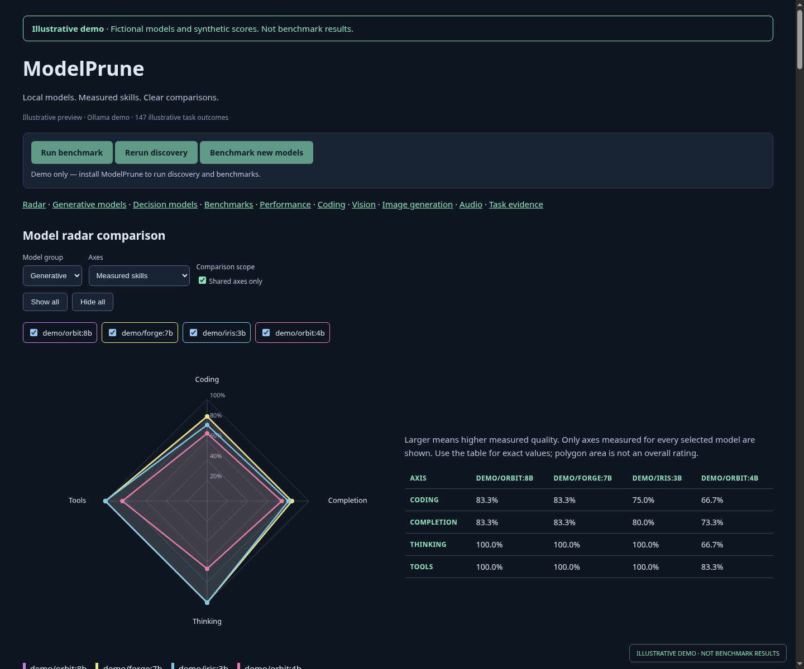
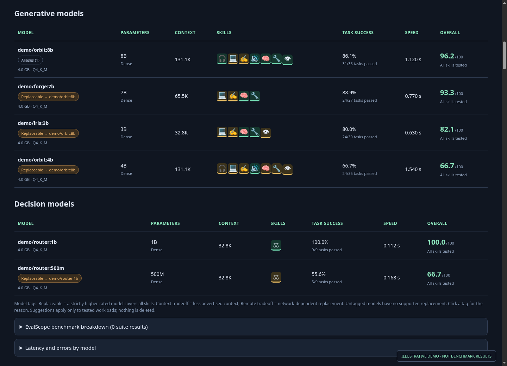

# ModelPrune

**Compare installed AI models by measured skills, speed and quality.**

ModelPrune discovers local model installations, benchmarks supported runtimes through EvalScope, and builds an interactive report. It helps you find overlapping models while preserving specialist skills.



*Preview uses fictional models and synthetic scores. It does not represent measured model performance.*

## Install

From a checkout of this repository:

```bash
./install.sh --open
```

The installer downloads exact Python versions and creates dedicated **EvalScope, speech and ComfyUI virtual environments**, using the full dependency snapshots in `requirements/`. It sets up grading assets and a private local report service. Installation does not run a benchmark.

**Requirements:** Linux x86_64, Python 3 for bootstrapping, internet access and a running Ollama installation. The image profile additionally needs Git, a compatible NVIDIA driver and existing image checkpoints. Runtime dependencies occupy several GB.

```bash
# Text, vision, decisions and audio evaluation without the image runtime
./install.sh --no-images --open

# Include image generation using your existing ComfyUI checkpoints
./install.sh --model-path ~/ai/ComfyUI/models --open
```

Large generative model weights are supplied by you. The installer downloads the small pinned Whisper grading model. [Installation options and troubleshooting →](QUICKSTART.md)

## Use

Open the initialized report and use:

- **Rerun discovery** to refresh installed models without running inference.
- **Benchmark new models** to preserve existing scores and evaluate new or changed models.
- **Run benchmark** to evaluate all supported installed models, including configured remote Ollama registrations.

The run buttons become a progress bar while work is active. Stop unrelated inference clients before benchmarking: each Ollama model is evaluated separately, and isolation failures are reported.

```bash
~/.local/share/modelprune/modelprune doctor
~/.local/share/modelprune/modelprune open
```

## What you get

- Broad discovery across Ollama, Hugging Face, ComfyUI, LM Studio, Jan, GPT4All and other local weight stores. Discovered weights without an evaluator remain visible and unscored.
- Compact, separate generative and decision tables with parameter size, context, skill icons, task success, speed and overall rating.
- Interactive radar charts with individual model toggles and explicit missing measurements.
- Coding, vision, image generation and audio sections, plus task evidence and EvalScope metric breakdowns.
- Weight-based alias detection so presets such as `*-work` do not count as separate models.
- Skill-aware overlap tags: **a better model can replace a worse one only if it has all of the worse model’s skills**. Context and remote-execution tradeoffs are marked. Nothing is deleted.



*Illustrative demo data. The report keeps generative and decision models separate.*

## Evaluation coverage

| Area | Method |
| --- | --- |
| Text and decisions | BoolQ, GSM8K, IFEval and local multilevel fixtures |
| Coding | Python/SQL tracing and debugging; generated code is not executed |
| Vision | Deterministic image color, counting and spatial fixtures |
| Listening and speech | Intelligible spoken fixtures; speech output graded by local CPU Whisper |
| Tools and thinking | Tool-call structure and reasoning-enabled answer fixtures |
| Image generation | Pinned ComfyUI workflow with coarse color/layout checks |

Every task score is assigned by EvalScope. These bounded tests measure scheduled workloads; they do not establish general capability. Image metrics do not measure artistic quality, and transcript matching does not measure voice naturalness. [Scoring, isolation and limitations →](docs/benchmarking.md)

## Documentation

- [Installation and operation](QUICKSTART.md)
- [Benchmarking reference](docs/benchmarking.md)
- [Architecture](docs/architecture.md)
- [Development and publication](docs/development.md)
- [Preview screenshots and reproducible demo](docs/previews.md)
- [Changelog](CHANGELOG.md)
- [Agent instructions](AGENTS.md)

## License

Original ModelPrune code is licensed under the [MIT license](LICENSE). Downloaded runtimes, datasets and model weights retain their own licenses; see [third-party notices](THIRD_PARTY_NOTICES.md).
