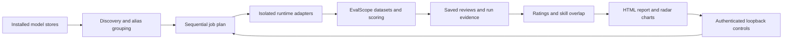

# Architecture

ModelPrune has one score pipeline: EvalScope schedules evaluations and assigns scores; the report imports its scored reviews.

## Runtime boundaries

The installer creates three isolated environments under the chosen prefix. EvalScope runs orchestration and framework scoring. The speech environment supplies CPU Whisper grading. The optional ComfyUI environment executes the supported image workflow with custom nodes disabled. Python versions, all package pins, the ComfyUI commit and Whisper revision are recorded in `runtime-versions.json` and `requirements/*.lock`.

Ollama remains an external service. Remote Ollama registrations use the account/provider already configured there. Discovery can find other weight stores, but a discovered model needs an implemented runtime adapter before it receives scores.

## Data and reports

Each run stores a job plan, raw framework reviews and imported per-task evidence. A completed run generates HTML, comparison CSV, discovery JSON and raw result JSON. Incremental evaluation verifies engine and fixture compatibility before merging new evidence. Discovery refresh filters current comparisons by present model identity while retaining history.

The product version and historical saved-run schema version are separate. Internal schema `7.0.0` is retained for existing unified EvalScope records; it is not a published product version.

## Report controls

The page calls a private loopback HTTP service with a token stored in installation configuration. The service accepts only discovery, full benchmark and incremental benchmark actions; the browser cannot supply arbitrary commands. Only one operation runs at a time. Progress comes from saved job/review evidence. Failed operations retain the previous published report.

Reports embed their control token and may contain model responses and local paths. They are private artifacts. Repository previews instead use synthetic data, empty credentials and disabled runtime controls.
