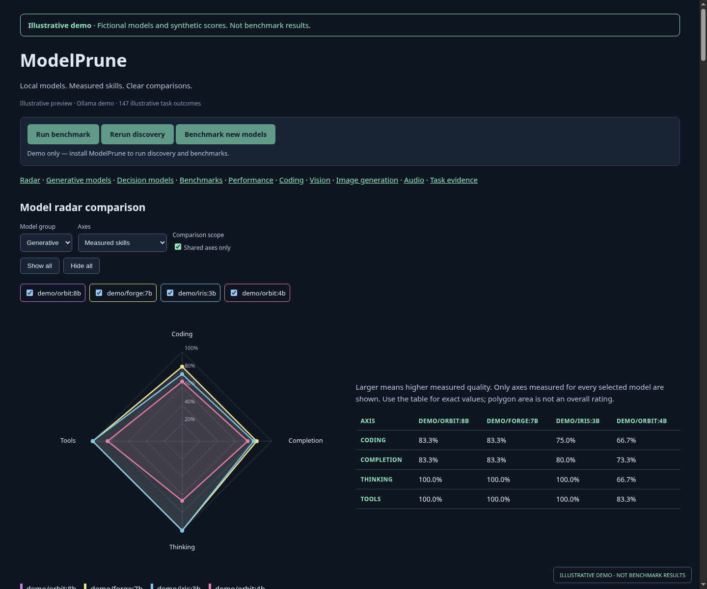
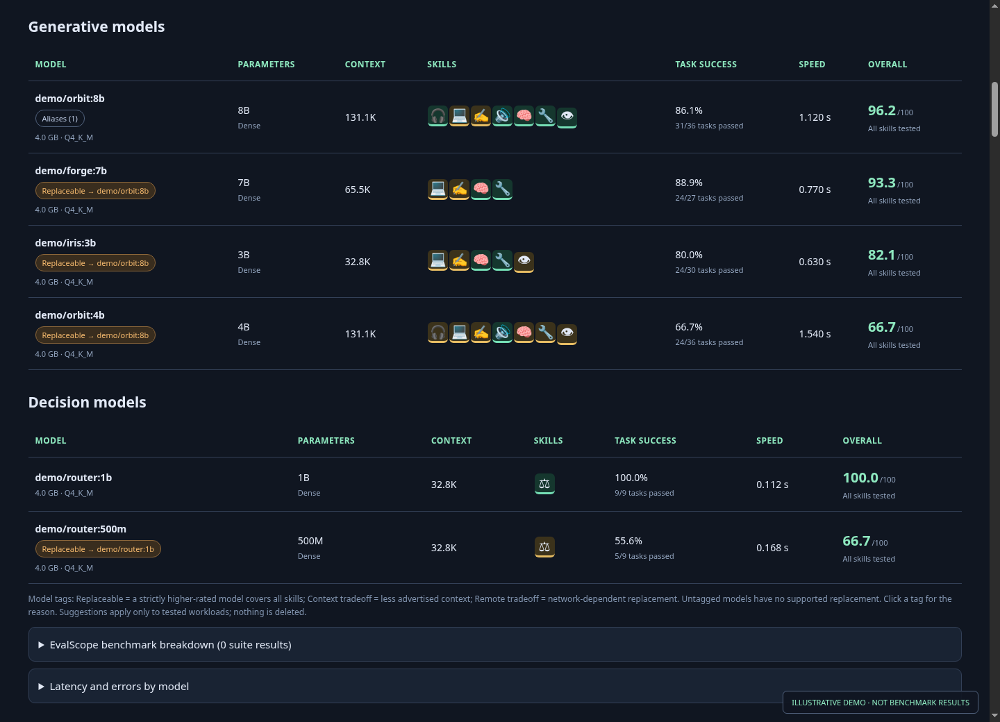

# Preview report and screenshots

The [offline demo report](preview.html) uses fictional model names and deterministic synthetic scores. It exercises the actual report renderer without reading local models, running inference or connecting to the control service. It is an interface preview, not benchmark evidence.





## Reproduce

From the repository root:

```bash
python3 tools/make_preview.py
node tools/capture_previews.mjs
```

The first command needs only Python 3. The second uses Node.js 22+ and Chromium (`CHROMIUM_BIN` can override the executable). It runs an isolated temporary browser profile, blocks network access, opens only the generated synthetic report and writes the two PNGs above. It does not open any private benchmark report.

Model controls are disabled in this demo. Install ModelPrune to run discovery or benchmarks.

The demo uses committed vision images in `docs/assets/`. PNG compression can vary between zlib implementations even when pixels match; reusing the same files keeps the generated HTML identical on local machines and CI. These assets affect only the documentation preview. When vision scenes change, update the demo assets to match and regenerate the preview.
